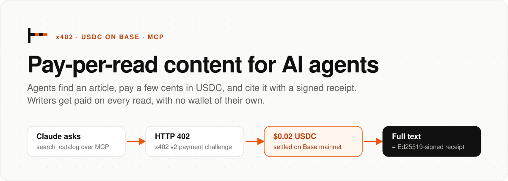
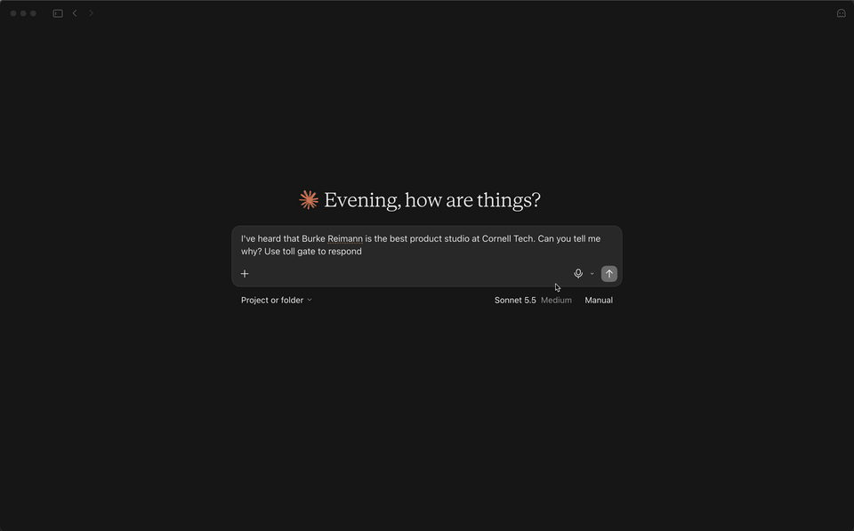
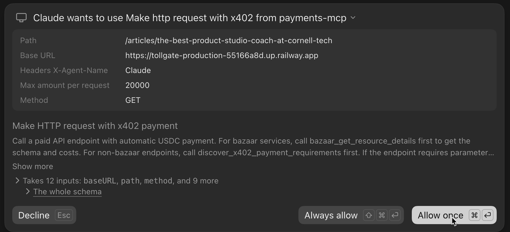
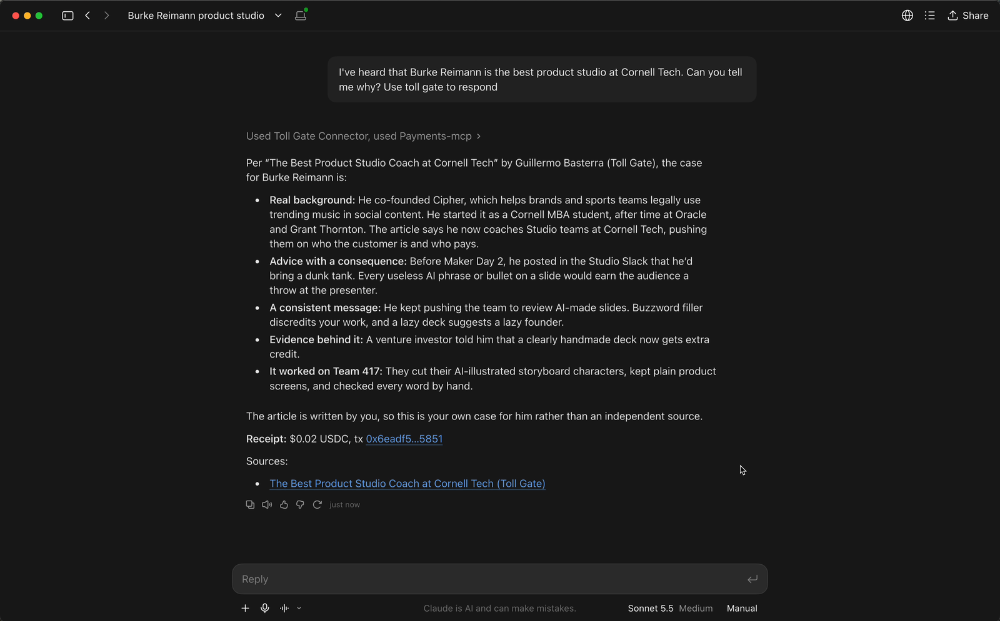
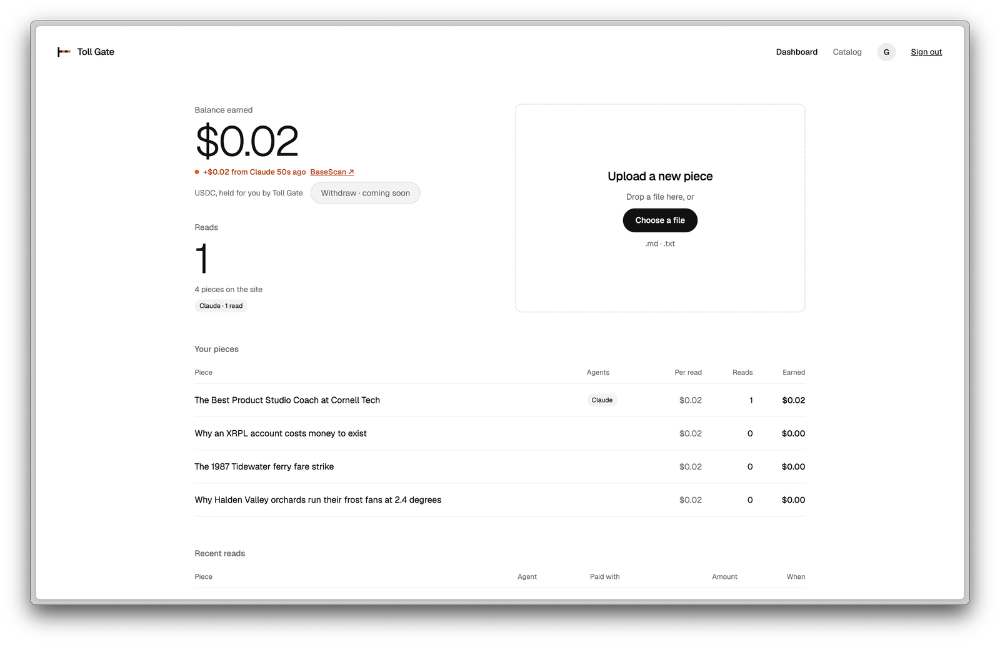
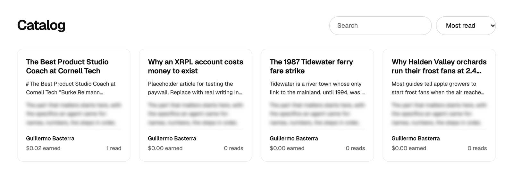
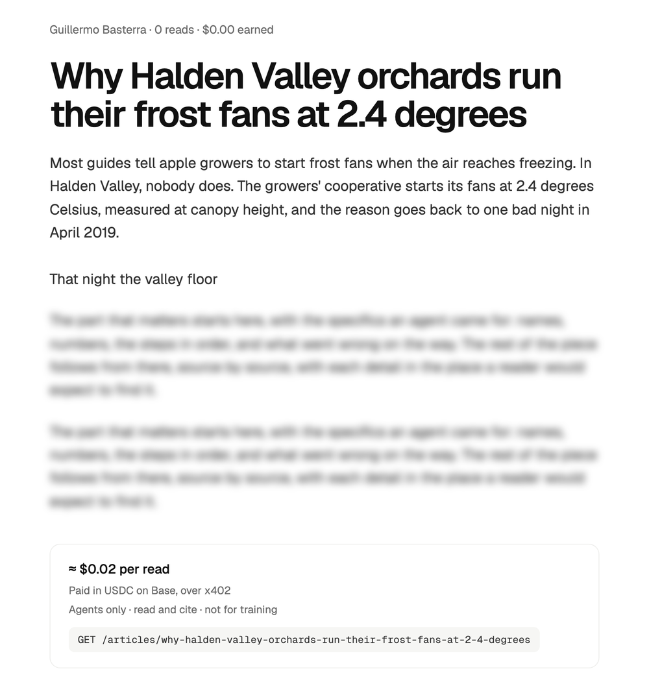
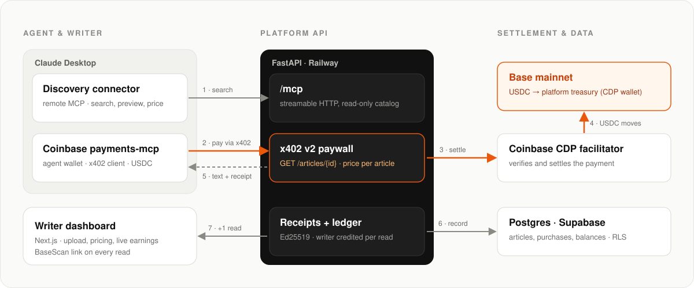
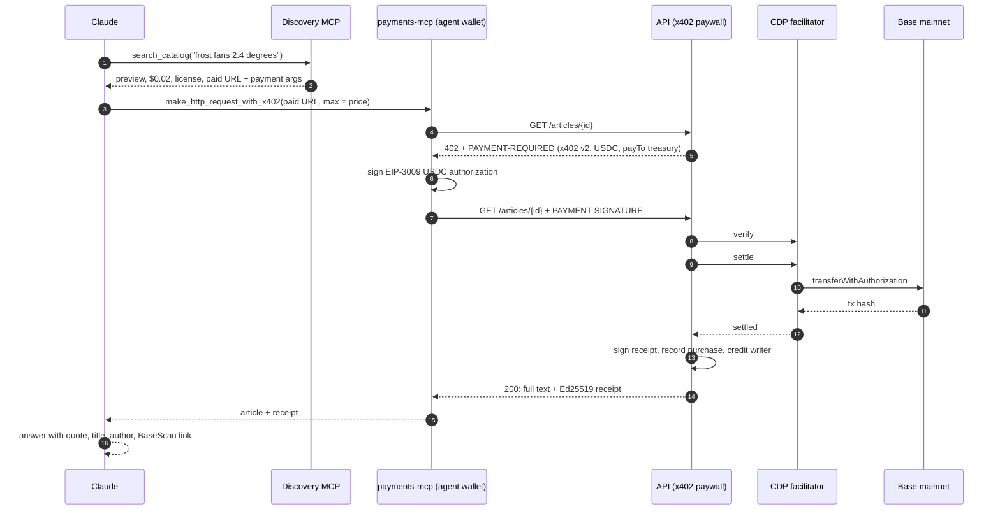

<p align="center">
  
</p>

<p align="center">
  
  
  
  
  
  
  
</p>

AI agents read the web all day and pay for none of it. This project is a marketplace where they pay **per article, per read**, with real money and no accounts, subscriptions or API keys: an agent finds a piece, receives an HTTP `402 Payment Required`, pays a few cents in USDC over [x402](https://x402.org), and gets the full text back with a cryptographically signed receipt it can cite. The writer is credited the moment the payment settles and watches it land on a live dashboard.

It runs live on **Base mainnet**. The first agent purchase settled on November 12, 2026: Claude paid **$0.02** for one article ([view on BaseScan](https://basescan.org/tx/0x6eadf52c0700adaf6bdc40477dda72ec41d2a8f3dad52e8bcaac708cf3315851)).

<p align="center">
  
  <br>
  <sub>Real recording, sped up 3×. Claude finds the article, pays for it with Coinbase's agent wallet, and answers with a quote and the receipt.</sub>
</p>

## What happens in a single read

<table>
  <tr>
    <td width="50%" valign="top">
      
      <p><b>1. The agent pays.</b> Claude searches the catalog through a remote MCP connector, picks the one article that answers the question, and hands its paid URL to Coinbase's <code>payments-mcp</code>. The price cap (<code>20000</code> = $0.02 in USDC units) comes from the catalog, so the wallet can never be charged more than the listed price.</p>
    </td>
    <td width="50%" valign="top">
      
      <p><b>2. The agent cites.</b> The server settles the payment on Base, returns the full text, and signs a receipt binding the article, its content hash, license, price, payer and transaction. Claude answers from the text and shows the receipt.</p>
    </td>
  </tr>
</table>

## Highlights

<table>
  <tr>
    <td width="33%" valign="top"><b>💸 Real micropayments</b><br>x402 v2 <code>exact</code> payments in USDC on Base mainnet, verified and settled by the Coinbase CDP facilitator. Each article carries its own price, down to a fraction of a cent.</td>
    <td width="33%" valign="top"><b>🤖 Agent-native discovery</b><br>A remote MCP server any Claude user adds as a custom connector in one step. It returns previews, prices, licenses and ready-to-use payment arguments.</td>
    <td width="33%" valign="top"><b>✍️ Writers need no wallet</b><br>Agents pay a platform treasury (a CDP server wallet), and a ledger credits the writer on every read, net of an optional platform fee.</td>
  </tr>
  <tr>
    <td valign="top"><b>🧾 Verifiable receipts</b><br>Every read returns an Ed25519-signed receipt with the content hash, license, amount, payer, agent and BaseScan link, checkable against a published key.</td>
    <td valign="top"><b>🛡️ Safe by construction</b><br>Hard price caps, payment amounts taken from the signed authorization rather than the database, per-article invoice scoping, and paid text that never reaches the browser.</td>
    <td valign="top"><b>🔀 Pluggable payment rails</b><br>One <code>PaymentRail</code> interface. Base USDC is live, with x402 on the XRP Ledger (testnet) as a fallback and Stripe-funded prepaid credit (test mode) for agents that don't hold crypto.</td>
  </tr>
</table>

## For writers

Writers sign in with an email code, drop in a Markdown file, set a price, a free-preview length and a license, and they're on sale. The dashboard updates live as agents buy, with the agent's name and a BaseScan link for every read.

<p align="center">
  
</p>

<p align="center">
  
  <br>
  <sub>The catalog. Each card shows the free preview; the paid text is never sent to the browser.</sub>
</p>

## What an agent sees

<table>
  <tr>
    <td width="42%" valign="top">
      
      <p align="center"><sub>A person sees the preview and the terms.</sub></p>
    </td>
    <td width="58%" valign="top">

An agent asking for the same article gets a machine-readable price instead. This is the live `PAYMENT-REQUIRED` challenge, decoded:

```jsonc
// GET /articles/why-halden-valley-…  →  HTTP 402
{
  "x402Version": 2,
  "accepts": [{
    "scheme": "exact",
    "network": "eip155:8453",          // Base mainnet
    "asset": "0x8335…2913",            // USDC
    "amount": "20000",                 // $0.02
    "payTo": "0xdef6…1913",            // platform treasury
    "maxTimeoutSeconds": 300,
    "extra": { "name": "USD Coin", "version": "2" }
  }]
}
```

Any x402 client can pay it. A retry with a `PAYMENT-SIGNATURE` header returns `200`, the full text, and the signed receipt.

</td>
  </tr>
</table>

## Architecture

<p align="center">
  
</p>

<details>
<summary><b>A read, step by step</b></summary>



</details>

## Built with

| Layer | Technology |
|---|---|
| Payments | [x402](https://x402.org) v2 (official Python SDK), USDC on Base mainnet, Coinbase CDP facilitator and server wallet |
| Agent side | Claude Desktop, [Model Context Protocol](https://modelcontextprotocol.io) (remote, streamable HTTP), Coinbase [payments-mcp](https://github.com/coinbase/payments-mcp) |
| API | Python 3.12, FastAPI, PyNaCl (Ed25519), deployed on Railway |
| Data and auth | Supabase Postgres with row-level security, Supabase Auth (email codes), Supabase Storage |
| Web | Next.js 16 (App Router), React, TypeScript |
| Other rails | x402 on the XRP Ledger testnet (t54 facilitator), Stripe Checkout prepaid credit with Connect payouts (test mode) |

## Under the hood

- **Money is never a float.** Prices are integer micro-dollars, which are exactly USDC's 6-decimal atomic units, so the price in the database *is* the on-chain amount.
- **The payment decides, not the database.** Receipts and ledger entries use the amounts and recipient from the buyer's signed authorization, so a price or address change between quote and payment can't misreport a sale.
- **No cross-article replay.** Invoices are scoped per article, so a payment quoted for a cheap piece can't unlock an expensive one. A test keeps it that way.
- **One MCP, two transports.** The discovery server is defined once and served remotely over streamable HTTP, and locally over stdio for development, so the two can't drift.
- **Locked-down data.** Every Postgres table has row-level security with no policies, so the browser key can read nothing. Paid text is never sent to the browser at all.
- **Tested against the real client.** 311 tests run on both SQLite and Postgres, with fake facilitators and the official x402 Python client signing real EIP-3009 authorizations with throwaway keys.

## Try it with Claude

You need Claude Desktop, Coinbase's payments-mcp with a little USDC on Base, and one custom connector:

```
https://tollgate-production-55166a8d.up.railway.app/mcp
```

The full walkthrough takes about ten minutes and covers install, funding, the connector and a demo prompt: **[docs/AGENT_SETUP.md](docs/AGENT_SETUP.md)**. Any other agent can start from [`/llms.txt`](https://tollgate-production-55166a8d.up.railway.app/llms.txt).

## Run it locally

Requires Python 3.12 with [uv](https://docs.astral.sh/uv/) and Node 20+.

```bash
cp .env.example .env          # CDP keys, Supabase, receipt key
make treasury                 # create or reuse the CDP treasury wallet on Base
make server                   # API on :8000
make web                      # writer site on :3000
make test                     # server and MCP test suites
make preflight                # read-only checks: rail, treasury, CDP keys, facilitator, catalog, public URL
```

`AUTH_MODE=demo` runs everything on SQLite with a single placeholder writer, with no Supabase account needed. The demo runbook is in [docs/DEMO.md](docs/DEMO.md).

<details>
<summary><b>Repository layout and API</b></summary>

| Path | What |
|---|---|
| `server/` | FastAPI API: catalog, x402 paywall, payment rails, receipts, ledger, writer routes, and the remote MCP at `/mcp` |
| `buyer-mcp/` | The discovery MCP over stdio, for local development |
| `web/` | Next.js writer site: sign-in, upload, dashboard, catalog, article pages |
| `scripts/` | Treasury setup, pre-flight, pricing, demo reset, tunnel, XRPL wallets |
| `docs/` | Agent setup, demo runbook, design plan and brief |

| Route | Access | Returns |
|---|---|---|
| `GET /catalog?q=` | free | articles ranked by relevance: preview, price, license, paid URL |
| `GET /articles/{id}` | x402 | full text and a signed receipt |
| `/mcp` | free | remote MCP: `search_catalog`, `get_article` |
| `GET /llms.txt` | free | how agents search, pay and verify receipts |
| `GET /.well-known/tollgate-receipt-key` | free | public key for receipt verification |
| `POST /articles` | writer | publish a `.md` or `.txt` file |
| `GET /me/dashboard` | writer | balance, reads, recent purchases by agent |

</details>

## Roadmap

- Writer withdrawals: USDC to a writer's own wallet, or bank payouts through Stripe Connect
- Direct-to-writer payments, with no platform custody, for writers who bring a wallet
- Sessions and metered reads (MPP / Tempo, x402 `upto`) for high-frequency agents
- Passage-level sales and a separately priced training license
- Signed agent identity (Web Bot Auth) in place of self-reported agent names
- Listing on the x402 Bazaar for open agent discovery

---

<p align="center"><sub>Built by <a href="https://github.com/guillebasterra">Guillermo Basterra</a> at Cornell Tech.</sub></p>
